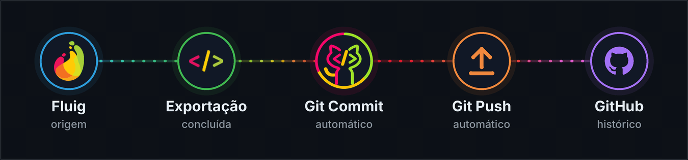
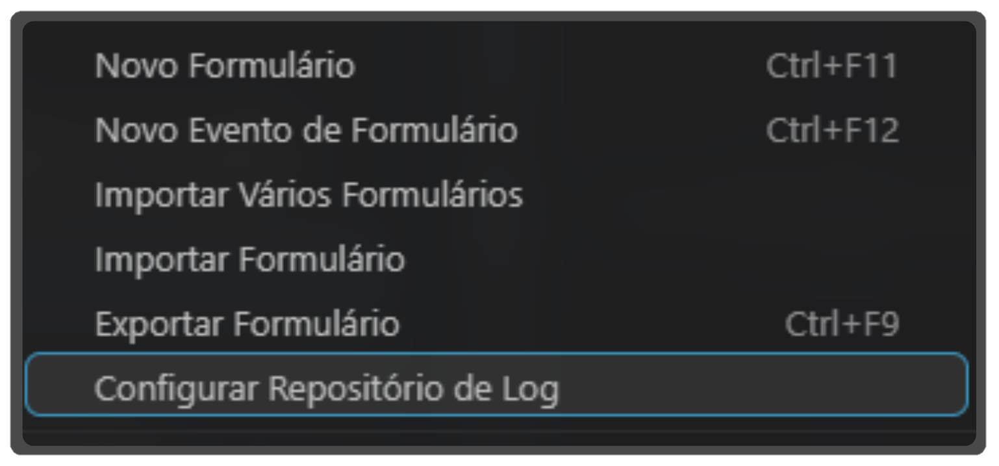
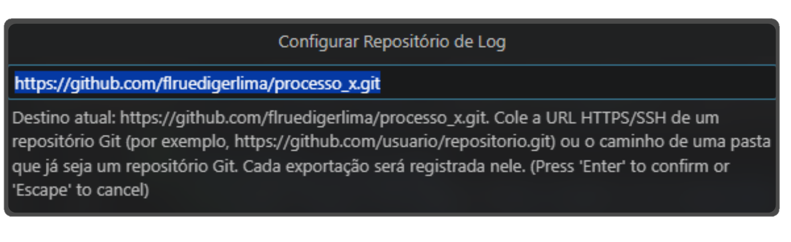
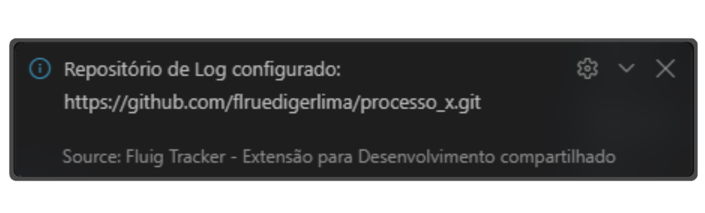
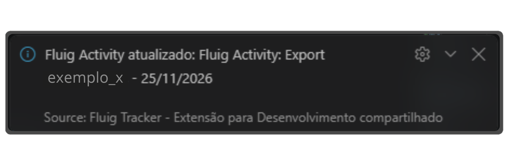
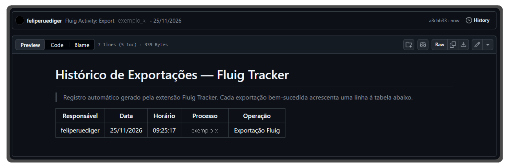
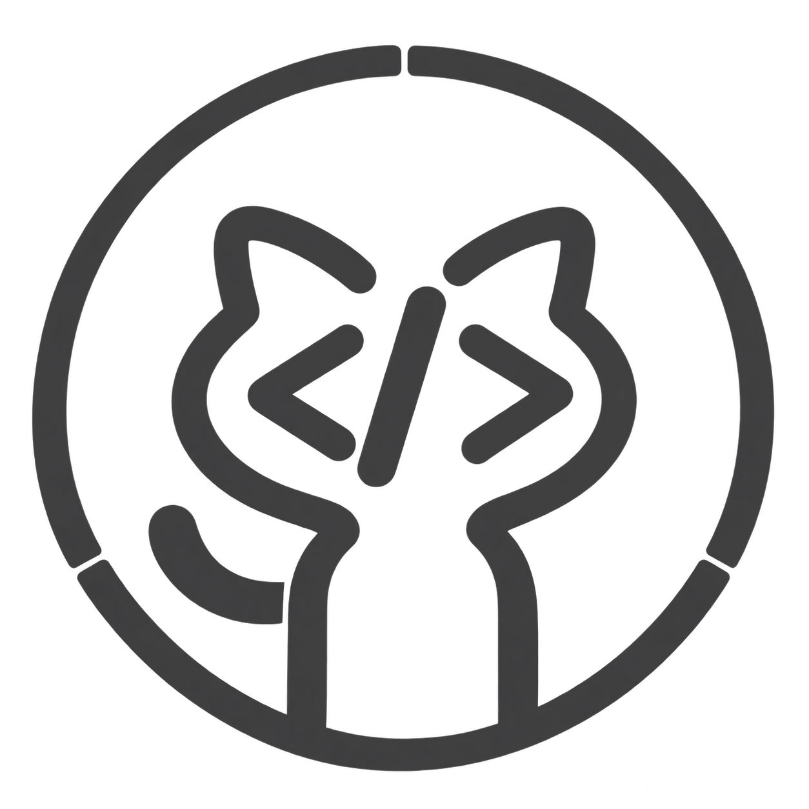

<!-- Arquivos usados por este README (pasta assets/): FluigTrackerBanner.webp, FluigTrackerIcon.png, FluigTrackerGifLoad.gif, fluxo-git.gif -->

  <h1>Fluig Tracker — Extensão para Desenvolvimento</h1>  
    
 
   
 
  
 
 <a href="#sobre">Sobre</a> &nbsp;•&nbsp; <a href="#git">Integração Git</a> &nbsp;•&nbsp; <a href="#instalacao">Instalação</a> &nbsp;•&nbsp; <a href="#creditos">Créditos</a> 
 

✨ Sobre o projeto

O Fluig Tracker é uma versão independente derivada da extensão de desenvolvimento Fluig, criada originalmente pela comunidade Fluiggers.

A proposta é preservar a experiência e os recursos da extensão original, adicionando uma integração com Git para registrar automaticamente as exportações realizadas no Fluig.

🔗 Integração com Git

A funcionalidade adicional permite registrar automaticamente uma exportação bem-sucedida, criar um commit e executar o push para um repositório remoto.

Dessa forma, o histórico de exportações pode ser acompanhado diretamente pelo GitHub, sem precisar registrar cada operação manualmente.

Como funciona

   
  
  
  Exportação da extensão original (Fluiggers) • commit e push automáticos pelo Fluig Tracker. 

Tecnologias e plataformas

    
 
 

## Registro automático de exportações

Configure um repositório Git pelo menu do formulário. Após cada exportação concluída, o Tracker acrescenta uma linha ao arquivo activity.md, cria um commit e envia o histórico ao repositório configurado.

### 1. Configurar o repositório pelo menu

**Etapa:** selecione Configurar Repositório de Log, logo abaixo de Exportar Formulário. **Aviso:** abrir essa opção apenas inicia a configuração; ainda não registra uma exportação.

### 2. Informar a URL ou o caminho do repositório

**Etapa:** informe uma URL Git HTTPS/SSH ou o caminho de um repositório Git local. **Aviso:** a conta precisa ter acesso de gravação. Configure a autenticação do Git no sistema e não coloque tokens ou senhas na URL.

### 3. Confirmar o repositório configurado

**Etapa:** a mensagem confirma que o destino foi salvo. **Aviso:** ela não confirma um commit; o registro só acontece depois de uma exportação bem-sucedida.

### 4. Verificar a confirmação da exportação

**Etapa:** após a exportação, a notificação confirma o registro. **Aviso:** ela aparece quando o commit e o envio ao remoto terminam com sucesso.

### 5. Consultar o commit no GitHub

**Etapa:** o histórico mostra o commit e a linha de activity.md. **Aviso:** o Tracker envia o histórico e os atributos de merge relacionados, não os arquivos-fonte do projeto Fluig.

## Créditos à comunidade Fluiggers

 &nbsp; → &nbsp; 

A seta representa a evolução da extensão original da comunidade Fluiggers para o Fluig Tracker. **Nada disso seria possível sem a extensão original.** O ícone colorido do Fluig Tracker é usado como ícone da extensão; a versão cinza aparece na barra lateral do VS Code.

📦 Instalação

A instalação é feita manualmente por meio do pacote .vsix.

Etapa	Instrução
01	Acesse a seção Releases.
02	Baixe o arquivo .vsix da versão desejada.
03	Abra o Visual Studio Code.
04	Pressione <kbd>Ctrl</kbd> + <kbd>Shift</kbd> + <kbd>P</kbd>.
05	Execute Extensions: Install from VSIX....
06	Selecione o arquivo baixado.

 
<b>💻 Prefere o terminal?</b>
  
bash
code --install-extension caminho/do/arquivo.vsix

[!NOTE] Configure o destino pelo comando Configurar Repositório de Log. O endereço, a autenticação e as permissões são definidos no ambiente de cada usuário.

🧩 Créditos e projeto de origem

Projeto baseado na extensão Fluig — Extensão para Desenvolvimento, criada pela comunidade Fluiggers.

Fluiggers

[!NOTE] Esta é uma iniciativa independente, sem vínculo oficial com a TOTVS nem representação oficial da equipe Fluiggers.

<strong>Desenvolvido com 💙 pela comunidade.</strong>  Fluig + Visual Studio Code + Git + GitHub

 

<a href="#top">⬆ Voltar ao topo</a>

